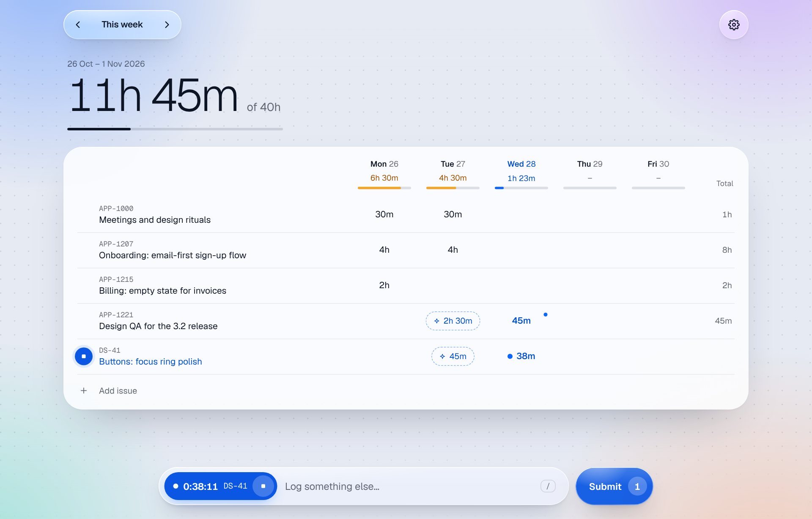

# Spent

A week-first timesheet for [YouTrack](https://www.jetbrains.com/youtrack/). Type your hours into a week, or log them in one line, and send them to YouTrack when the week looks right.

Spent runs on your own computer. Nothing gets installed in YouTrack: Spent talks to it with your personal token, the same way you would.

<picture>
  <source media="(prefers-color-scheme: dark)" srcset="docs/spent-dark.png">
  
</picture>

## What it does

- **One line to log.** `APP-1207 1h30 review copy` in the bar at the bottom, Enter. Leave the time out and Enter starts a timer instead.
- **A week you can type into.** Click a cell, or focus it and type a number. Totals per day fill a small meter toward your daily target; short days turn amber.
- **Suggestions in place.** Your comments, field changes, attachments and commits in YouTrack show up as dashed values in the week. Click one to add it.
- **Nothing reaches YouTrack until you submit.** Submit appears when there's something to send. It checks first, writes each change, and retries a network failure without creating duplicates.
- **Undo** on every log, from the toast.

## Start

You need [Node.js](https://nodejs.org) 20 or newer (`node -v`). Nothing else: no `npm install`.

```sh
git clone https://github.com/mateuszbartosik/spent.git
cd spent
npm start
```

On Windows you can also double-click `start.cmd`. Spent opens <http://localhost:5178>. Keep its window open while you use it; Ctrl+C stops it.

## Connect YouTrack

1. In YouTrack, open your avatar → **Profile** → **Account Security**.
2. Under **Tokens**, choose **New token…**, name it "Spent", give it the **YouTrack** scope, and copy it.
3. In Spent, enter your YouTrack's address (for example `https://yourcompany.youtrack.cloud`) and paste the token.

## Try it without touching YouTrack

`npm run demo` (or double-click `demo.cmd`) opens <http://localhost:5179> against a fake YouTrack with sample data. It starts fresh every time.

## The bar

| Type | Means |
|---|---|
| `APP-1207` | the issue (any letter case). No ID? Words from the issue's title work when exactly one issue matches. |
| `1h30` `1.5` `90m` `90` `1:30` `9:00-10:30` | the time. Whole numbers up to 12 are hours, bigger ones minutes. No time: Enter starts a timer. |
| `today` `yesterday` `mon` … `sun` `mon-fri` `2026-10-27` | the day (default: today). `mon-fri` makes one work item per day. |
| `#review` | the work type. A unique start is enough (`#rev`). Without it, your default for that project is used. |
| anything else | the note. |

Press `/` anywhere to jump to the bar. A running timer sits at the left end of the bar; click it to stop it at the end of your day, keep it all, or discard it.

## The week

- Click a cell, or focus it and type a number, to edit: time, −/+ 15 minutes, type, note. Enter saves, Tab goes to the next day, ↑ ↓ to the next row, Esc cancels. Arrow keys move between cells.
- Hover a row for ▶ (start a timer on it). **Add issue** puts any issue in the week before you log on it. An empty week offers last week's issues.
- Cells: plain = in YouTrack, blue with a dot = not sent yet, struck through = will be removed, red dot = the last send failed (the reason is in the cell's editor), dashed = a suggestion.
- Days off are hidden unless something happened on them.

## Settings

Daily target, work days, end of your day, timer rounding, and a **default work type per project**. Some projects have no "Design" type, so pick what your usual work goes in as, once. Setting a default also fills drafts that don't have a type yet.

## Look

Controls float on a liquid glass layer over a quiet week. In Chrome and Edge the edges of the glass also bend what's behind them; other browsers get the frosted version. Spent follows your system's light or dark mode, and its Reduce transparency, Increase contrast and Reduce motion settings.

## Where your data lives

- `data/config.json`: the YouTrack address and your token, in plain text. **Settings → Change** replaces them; deleting the file disconnects Spent. Keep the folder private, and revoke the token in YouTrack if this computer is ever lost.
- `data/state.json`: drafts, edits that aren't submitted yet, the running timer and your settings. Submitted time lives only in YouTrack.

Both are in `.gitignore`, so they stay out of commits.

## Safety

- Spent listens on 127.0.0.1 only. Its API refuses requests without its own header and checks the Host and Origin, so other web pages can't drive it.
- The token never reaches the browser, and Spent won't follow a redirect from https to http with it.
- It writes only your own work items. A create that times out is looked up before it's retried, so it can't land twice.

## Troubleshooting

| Problem | Fix |
|---|---|
| "Port 5178 is already in use" | Spent is probably already running: open <http://localhost:5178>. Or set `SPENT_PORT=5180` before starting. |
| "Couldn't reach …" | Check the address, and your VPN if YouTrack needs one. |
| "YouTrack turned the token down" | Make a new permanent token with the YouTrack scope. |
| No suggestions | They need YouTrack's activity API (2020+). A note under the week shows the error if a request failed. |
| Behind a proxy | Node doesn't use the system proxy. Set `NODE_USE_ENV_PROXY=1` and `HTTPS_PROXY` (Node 22.21 or newer). |

## Development

- `npm test` runs the parser, suggestion and API tests against a fake YouTrack (`test/mock-youtrack.js`). No install needed. CI runs them on Node 20, 22 and 24, and on Windows.
- `server.js` starts `lib/app.js` (routes, storage, submit, timer, suggestions). `lib/youtrack.js` is the REST client.
- The UI is `public/app.js` (Preact + htm, vendored in `public/vendor/`, no build step). `public/glass.js` draws the refraction.

## License

[MIT](LICENSE). Spent includes [Preact](https://preactjs.com) and [htm](https://github.com/developit/htm) (MIT) and the [Geist](https://vercel.com/font) fonts (SIL Open Font License 1.1); their licenses sit next to them in `public/vendor/` and `public/fonts/`.

Spent is not affiliated with JetBrains. YouTrack is a trademark of JetBrains s.r.o.
